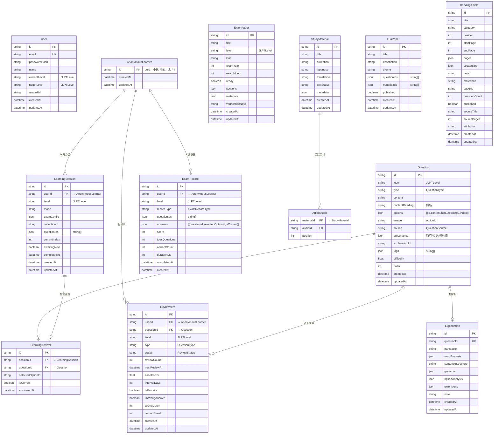

# 数据库与浏览器数据边界

## ER 概览

## 数据库归属

### 用户库 (`USER_TURSO_URL`)

| Model | 说明 |
|-------|------|
| `User` | 注册用户账号（email / 密码哈希 / 昵称 / 等级）；表结构见 `prisma/user-schema.sql` |

### 内容库 (`TURSO_URL` / `DATABASE_URL`)

| 分组 | Model | 说明 |
|------|-------|------|
| 身份 | `AnonymousLearner` | 匿名学习者不透明 ID，无 PII |
| 题目系统 | `Question` | 题目（含选项、难度、标签） |
| 题目系统 | `Explanation` | 解析（词汇分析 / 语法 / 选项解析） |
| 学习会话 | `LearningSession` | 一次练习/考试会话 |
| 学习会话 | `LearningAnswer` | 会话中的单条答题记录 |
| 考试记录 | `ExamRecord` | 一次模考/练习/复习的完整快照 |
| 复习 | `ReviewItem` | SM-2 间隔复习项 |
| 内容管理 | `ExamPaper` | 试卷（含分块与素材引用） |
| 内容管理 | `StudyMaterial` | 素材文章（标题 / 原文 / 译文 / 分类） |
| 内容管理 | `ArticleAudio` | 素材 ↔ 外部音频对象 ID 映射 |
| 内容管理 | `FunPaper` | 趣味闯关题组 |
| 内容管理 | `ReadingArticle` | 趣味阅读文章与分页 |

## 为什么两库之间没有外键

- **跨库外键不受支持**: Turso/LibSQL 是独立数据库实例，没有 dblink 机制，无法在 SQL 层面建立跨库约束。
- **职责分离**: 内容库只存「一个不透明的 `userId`」，不持有任何邮箱/密码/姓名等 PII。即使内容库被导出或被第三方审计，也无法从中还原真实用户身份。
- **生命周期解耦**: 用户库可以独立迁移、备份、扩容，不影响内容库；反之亦然。
- **应用层一致性**: 账号删除/注销由业务层编排——先清除内容库中该 `userId` 的所有记录（`AnonymousLearner` 级联会清掉 Session/ExamRecord/ReviewItem），再删 User。

未来如需强关联（例如「账号绑定」），在应用层用 `userId` 做逻辑关联即可；不需要数据库级外键。

## 内容库细节

- `ReadingArticle`：趣味阅读的文章、分页和词卡。
- `FunPaper`、`Question`、`Explanation`：趣味闯关题组、题目与解析；`ReadingArticle.paperId` 或 `FunPaper.materialIds` 关联对应原文。
- `StudyMaterial`：素材阅读馆的文章标题、原文、译文和分类。
- `ArticleAudio(materialId, audioId, position)`：素材文章与外部音频对象 ID 的对应表。`materialId` 外键指向文章，`audioId` 唯一，允许一篇文章按顺序关联多个音频；同一个音频只能归属于一篇文章。
- `AnonymousLearner`、`LearningSession`、`LearningAnswer`、`ExamRecord`、`ReviewItem`：只有匿名 ID 和服务端练习记录，不存储邮箱、姓名、密码等账号资料。

音频对象保存在 Cloudinary。数据库只保存 `audio-101` 这样的对象 ID；后端使用 `AUDIO_PUBLIC_BASE_URL` 生成播放地址。切换媒体提供方只需调整服务端配置和外部对象，无需往内容库写 URL 或媒体元数据。内容库没有音频／视频文件、媒体元数据表或 PDF 字段。

## 用户库细节

这是独立的 Turso 数据库，`User` 表存储未来注册账号的邮箱、密码哈希、昵称与等级。目前该表为空。`ENABLE_USER_REGISTRATION=false` 时注册接口关闭；以后开放注册时，服务端用同一个不含个人信息的 ID 关联内容库中的学习记录。两库之间没有跨库外键。

用户库初始化：`npm run db:init:users`。内容库一次性迁移：`npm run db:migrate:content`。两个命令都需要各自的 Turso URL 和令牌；`.env` 不提交到 Git。

## 浏览器

Vue 只在页面显示时持有接口响应，不写 `localStorage`、`sessionStorage` 或 IndexedDB。旧版保存的 `learning_token` 会在首次加载时删除。浏览器只保留 `HttpOnly`、`SameSite=Lax` 的 `ja_session` Cookie；学习记录和成绩保存在服务端，API 响应标记 `Cache-Control: no-store`。清除 Cookie 会失去对匿名学习记录的访问，因此未来账号功能需要提供正式的关联与恢复流程。

旧的 PDF/媒体导入脚本是历史工具，不能用于新内容库结构。新增素材时先写入 `StudyMaterial`，上传音频到外部存储，再添加 `ArticleAudio` 对应关系；新增趣味闯关题组时按 `FunPaper.materialIds` 指向文章。

## Enum 约定

SQLite 不支持 enum，使用 `String` 字段 + 应用层校验。完整枚举值列表见 `prisma/schema.prisma` 顶部注释块；每个使用字段旁也就近标注了所属枚举名。
